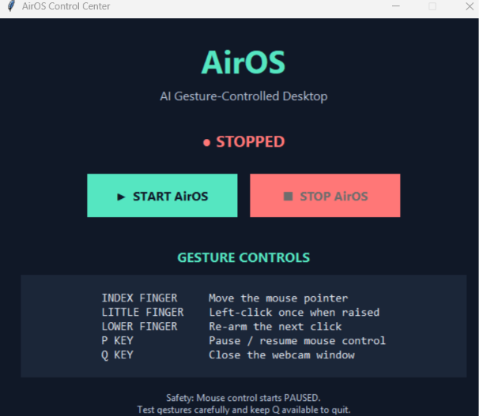
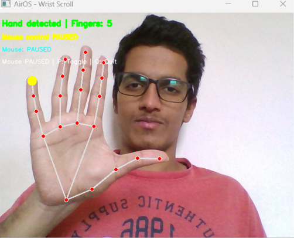

# AirOS — AI-Powered Gesture-Controlled Desktop

AirOS is a Python-based computer vision project that allows users to interact with their desktop using hand gestures captured through a webcam. It combines real-time hand tracking, finger detection, and gesture-based mouse control to explore a more natural, touch-free computing experience.

## 🎬 Demo Video

[▶ Watch the AirOS Demo](AirOS-Demo.mp4)

## 📸 Screenshots

### AirOS Dashboard


### Gesture-Based Wrist Scrolling


## ✨ Features

- **Real-Time Hand Tracking:** Detects and tracks hand landmarks using a webcam.
- **Finger Detection:** Identifies the number of extended fingers.
- **Gesture-Based Mouse Movement:** Controls the mouse pointer using the index fingertip.
- **Gesture-Based Clicking:** Uses a raised little finger to trigger a left-click.
- **Gesture-Based Scrolling:** Demonstrates scrolling through hand gestures.
- **Control Panel:** Includes a visual interface for managing the application, if enabled.
- **Keyboard Shortcuts:** Pause or resume mouse control and exit the application.
- **Safety Controls:** Includes PyAutoGUI's fail-safe mechanism.

## 🛠️ Technology Stack

- Python 3.11
- OpenCV
- MediaPipe
- NumPy
- PyAutoGUI
- Pytest

## ⚙️ How It Works

1. The webcam captures live video.
2. OpenCV processes the video frames.
3. MediaPipe detects hand landmarks and tracks finger positions.
4. AirOS interprets the hand gestures.
5. PyAutoGUI translates supported gestures into mouse actions.
6. The application displays tracking information and control status.

## 💻 Requirements

- Windows 10 or Windows 11
- Python 3.11
- A working webcam
- Git (optional)

## 🚀 Installation and Setup

### 1. Clone the Repository

```bash
git clone https://github.com/SujalPatil1616/AirOS.git
cd AirOS
```

Alternatively, download the repository as a ZIP file and extract it.

### 2. Create a Virtual Environment

```powershell
py -3.11 -m venv .venv
```

### 3. Install Dependencies

```powershell
.\.venv\Scripts\python.exe -m pip install -r requirements.txt
.\.venv\Scripts\python.exe -m pip install pyautogui
```

### 4. Run AirOS

```powershell
.\.venv\Scripts\python.exe -m airos
```

### 5. Run Tests

```powershell
.\.venv\Scripts\python.exe -m pytest -v
```

## 🎮 Controls

| Input | Action |
|---|---|
| Index finger | Move the mouse pointer |
| Little finger raised | Trigger a left-click |
| `P` | Pause or resume mouse control |
| `Q` | Quit the webcam application |

**Note:** Lower the little finger before raising it again to trigger another click. Keep your hand visible to the webcam for reliable tracking.

## 📁 Project Structure

```text
AirOS/
├── airos/
│   ├── __init__.py
│   ├── __main__.py
│   ├── control_panel.py
│   └── gestures.py
├── docs/
│   └── ROADMAP.md
├── tests/
│   └── test_gestures.py
├── .gitignore
├── README.md
└── requirements.txt
```

## 🔒 Safety Notes

- Start with mouse control paused and activate it when ready.
- Keep your hand within the webcam's field of view.
- Avoid using gesture control for sensitive actions.
- PyAutoGUI's fail-safe can stop automation if the mouse is moved to the top-left corner of the screen.

## 🔮 Future Improvements

- Improve pointer calibration and movement smoothing.
- Add configurable gesture mappings.
- Expand scrolling and support additional gestures.
- Improve the control panel with live status indicators.
- Package AirOS as a standalone Windows application.

## 👨‍💻 Author

**Sujal Patil**

GitHub: [@SujalPatil1616](https://github.com/SujalPatil1616)

---

*AirOS is an experimental desktop interaction prototype developed to explore computer vision, hand gesture recognition, and human-computer interaction.*
